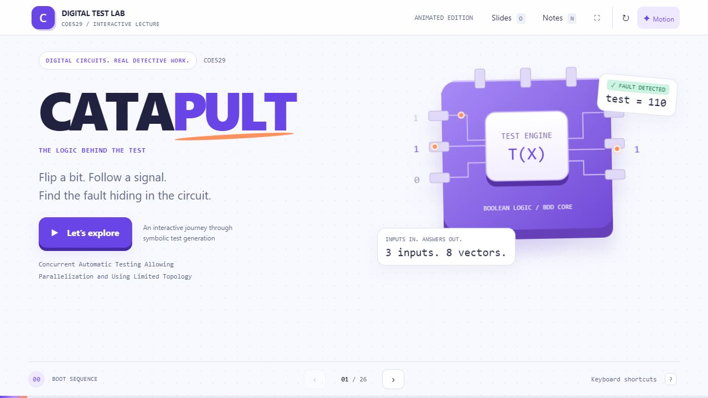

# CATAPULT — Digital Test Lab

A light-themed, animated 26-slide interactive presentation based on the two supplied CATAPULT lectures for COE529. Built with dependency-free HTML, CSS and JavaScript.

The original lecture decks are in [`lectures/`](lectures/). A packaged copy of the editable app is in [`downloads/CATAPULT-Source.zip`](downloads/CATAPULT-Source.zip).

## Present offline

Open `offline/CATAPULT-Presentation.html` in Chrome, Edge or Firefox. Everything is embedded, including the original benchmark table images. No installation, server or internet connection is required. Use browser fullscreen for a projector.

- **Right arrow / Space**: next slide
- **Left arrow**: previous slide
- **Home / End**: first / last slide
- **O**: slide map
- **N**: speaker notes (visible on the same screen)
- **F**: fullscreen
- **R**: replay the slide entrance
- **M**: toggle animations
- **?**: shortcut help
- **Esc**: close notes or overlay

Click the input switches, truth-table rows, algorithm stages and quiz answers. The test lab’s **Run all inputs** button plays every vector and stops automatically. On the derivation slide, **Reveal next step** introduces each equation. Correct quiz answers receive a short confetti animation. Motion is optional and respects the browser’s reduced-motion preference. On small screens the slide body scrolls while navigation stays available.

## Edit

`dist/app.js` contains the slide content, speaker notes, circuit simulation and controls. `dist/style.css` contains the base layout. `dist/theme.css` contains the light theme and animations. `dist/index.html` is the hosted entry point. After editing, run `node build-offline.mjs` to rebuild the standalone HTML.

For a local server, run `python -m http.server 4173 --directory dist` and open `http://localhost:4173`.

## Sources and scope

- CATAPULT PPT 2.pptx: detailed workflow, checkpoint set, partial composition and original c432 result tables.
- CATAPULT_ATPG.pptx: background, small educational examples, redundancy, history and BDD limitations.

The simulator exhaustively evaluates the lecture’s small example, `w=AB`, `F=wC+w′B`. It is a teaching demonstration rather than a general CATAPULT implementation. Both stuck-at values are supported. The consensus example `F=AB+A′C+BC` checks redundancy of `h=BC` stuck-at-0.

Source attribution and caveats are included in the speaker notes and source slide. Published references are carried over from the supplied lectures and were not independently reviewed. The exponential growth illustration is mathematical, not measured CATAPULT performance. The original timing table does not visibly identify its timing unit or full experiment setup.
